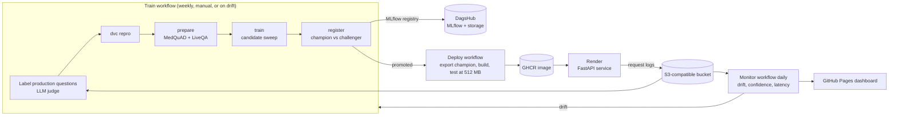

# MedRAG Ops

A medical question-answering service (retrieval-augmented generation over NIH's MedQuAD collection) with the full MLOps loop around it: versioned data and pipelines, tracked experiments, a model registry with an evaluation gate, CI/CD to a container host, production monitoring with drift detection, and automated retraining.

**[Live demo](https://medrag-ops.onrender.com/)** · **[Monitoring dashboard](https://tusharpn5701.github.io/medrag-ops/monitoring/)** · **[Experiments (MLflow on DagsHub)](https://dagshub.com/tusharpn5701/medrag-ops/experiments)**

Everything runs on free tiers: GitHub Actions, GitHub Container Registry, GitHub Pages, DagsHub, Render and Groq.



## What it does

Ask a consumer health question ("my dad has high blood pressure, what should he eat?"). The service retrieves the most relevant passages from 28,844 chunks of NIH answers (cancer.gov, GARD, Genetics Home Reference, MedlinePlus, NIDDK, NINDS, NHLBI, CDC, NIHSeniorHealth). An LLM writes a short answer that cites every sentence ([1], [2]). If no LLM key is set, or the provider fails, the service quotes the best passages instead, so it never goes down because a third-party API did.

## The MLOps loop

| Stage | What happens | Where |
|---|---|---|
| Data | `dvc repro` downloads MedQuAD (CC BY 4.0) and the TREC 2017 LiveQA-Med graded judgements, chunks 16,407 answers and builds three eval sets | `dvc.yaml`, `src/medrag/data.py` |
| Experiments | Every candidate retriever is fitted, scored and logged to MLflow with its parameters, metrics and per-query results | `params.yaml`, `src/medrag/train.py` |
| Selection | The best candidate on the **validation** split becomes the challenger | `selection.metric` |
| Registry gate | Challenger and current champion are both re-scored on the **held-out** split; the challenger becomes champion only if it is strictly better and passes guardrails | `src/medrag/registry.py` |
| CI | Lint, 20 unit/API tests, a retrieval quality gate against `reports/baseline.json`, and a Docker smoke test capped at 512 MB | `.github/workflows/ci.yml` |
| CD | The champion is exported from the registry, baked into an image, tested, pushed to GHCR (tagged by commit and model version) and rolled out on Render | `deploy.yml` |
| Logging | Every request (redacted query, top hits, scores, latency, model version) goes to an S3-compatible bucket | `src/medrag/logsink.py` |
| Monitoring | A daily job compares production questions with the reference set, tracks retrieval confidence, latency and feedback, and publishes the dashboard | `monitor.yml`, `src/medrag/monitor.py` |
| Feedback | Recent low-confidence production questions are graded by an LLM judge and added to the next run's selection set | `src/medrag/feedback.py` |
| Retraining | Drift, low confidence or poor feedback triggers the train workflow (with a 3-day cooldown); a promotion triggers deploy | `train.yml` |

### Evaluation data

* **MedQuAD known-item (1,000 questions):** templated questions ("What are the symptoms of X?") whose source answer is the target. Easy, but it catches tokenisation and chunking regressions.
* **LiveQA consumer questions (39 questions, split 20 val / 19 test):** real questions people sent to the NLM, with answers graded 1 to 4 by NIH assessors. Of 565 graded answers from the CC-licensed subsets, all 565 map onto this corpus. This is the honest test, and it is small.

### Results so far

From the first full training run on GitHub Actions (October 2026):

| Retriever | MedQuAD recall@5 | LiveQA val nDCG@10 | LiveQA test nDCG@10 |
|---|---|---|---|
| **bge-small** (pretrained ONNX, current champion v1) | 0.951 | 0.403 | 0.443 |
| BM25 | 0.779 | 0.233 | 0.424 |
| LSA-256, trained on this corpus | 0.259 | 0.143 | 0.156 |

Hybrid candidates (BM25 + LSA, BM25 + bge) are scored in every run and logged to MLflow.

The pretrained embedding model wins clearly on validation, which is what selection uses, and edges BM25 on the held-out test split. BM25 stays a strong baseline because medical questions hinge on exact disease names. The corpus-trained LSA model blurs those names together, and fusing it in hurts. The gate handles both cases without a human in the loop: a retrain on unchanged data produced an identical bge model, which was registered as v2 but not promoted, and in local testing an LSA challenger was blocked by both guardrails.

### Drift detection, explained

The monitor trains a classifier to tell recent production questions from the reference questions the model was evaluated on. A cross-validated ROC AUC near 0.5 means they look alike. Above 0.75 counts as drift, and the classifier's most heavily weighted words show what changed. When fed real LiveQA consumer questions against the templated reference, it reported AUC 0.94, with production leaning on words like *cause, taking, drug, thank* and the reference on *treatments, syndrome, symptoms*. That is the shift from catalogue-style questions to how people actually write.

## Running it locally

```bash
pip install -e ".[train,dev]"
dvc repro                     # download -> prepare -> train -> register (local MLflow in mlflow.db)
medrag export                 # champion bundle -> artifacts/bundle
medrag serve                  # http://localhost:8000 (demo page, /docs for the API)
pytest && ruff check src tests
medrag doctor                 # checks MLflow, the log bucket, the LLM key and embedding speed
mlflow ui --backend-store-uri sqlite:///mlflow.db
```

Set `GROQ_API_KEY` to get LLM answers; without it the service uses extractive answers.

## Deploying your own copy

1. **DagsHub:** create a repo connected to this GitHub repo, then create an access token.
2. **Groq:** create a free API key.
3. **GitHub secrets** (Settings, Secrets and variables, Actions):

   | Secret | Value |
   |---|---|
   | `MLFLOW_TRACKING_URI` | `https://dagshub.com/<user>/medrag-ops.mlflow` |
   | `MLFLOW_TRACKING_USERNAME` | your DagsHub username |
   | `MLFLOW_TRACKING_PASSWORD` | your DagsHub token |
   | `MEDRAG_LOG_BUCKET` | `medrag-ops` (the DagsHub repo name) |
   | `MEDRAG_S3_ENDPOINT_URL` | `https://dagshub.com/api/v1/repo-buckets/s3/<user>` |
   | `AWS_ACCESS_KEY_ID` / `AWS_SECRET_ACCESS_KEY` | your DagsHub token (both) |
   | `GROQ_API_KEY` | your Groq key |
   | `MEDRAG_ADMIN_TOKEN` | any long random string |
   | `RENDER_DEPLOY_HOOK_URL` | from Render, after step 5 |

   And one **variable**: `MEDRAG_PUBLIC_URL` = your Render URL.
4. Run **Train**, then **Deploy** from the Actions tab. Make the `medrag-ops` package on GHCR public (Packages, Package settings) so Render can pull it.
5. **Render:** New, Web Service, Existing image `ghcr.io/<user>/medrag-ops:latest`, instance type Free. Add the environment variables `GROQ_API_KEY`, `MEDRAG_ADMIN_TOKEN`, `MEDRAG_LOG_BUCKET`, `MEDRAG_S3_ENDPOINT_URL`, `AWS_ACCESS_KEY_ID`, `AWS_SECRET_ACCESS_KEY` and `AWS_DEFAULT_REGION=us-east-1`. Copy the deploy hook URL into the GitHub secret.
6. **GitHub Pages:** serve the `docs/` folder from `main`.

## Design notes and limitations

* **Small held-out set.** The promotion decision rests on 19 graded consumer questions, so small differences are noise. Guardrails on the 1,000-question MedQuAD set guard against obvious regressions.
* **Unjudged answers count as non-relevant**, as in TREC pooling, so absolute scores understate quality.
* **LLM-judged production labels** are pooled from the current champion only, so they favour it. They inform selection; the NIH-judged test split alone decides promotion.
* **Retrieval confidence** is the best hit's BM25 score against the 10th percentile of reference queries. On a 25-question off-topic probe it separates off-topic from medical questions with AUC 0.91, which is useful as a monitoring signal but not as a hard refusal rule.
* **Embedding cost:** embedding the 28,844 passages with bge-small takes most of an hour on a free GitHub runner, so embeddings are cached by (model, corpus) hash between runs. Retraining is fast until the corpus changes.
* **Free-tier trade-offs:** Render's free instance sleeps after 15 minutes, so the first request can take a minute. Request logs are batched to the bucket every 25 requests or 60 seconds and on shutdown, and the monitor flushes the live service before it reads.
* **Registry roles** use MLflow aliases where the server supports them and fall back to version tags otherwise.
* **Privacy:** emails and phone numbers are stripped before any query is logged. The demo asks users not to enter personal details.

## Data and licence

MedQuAD: Ben Abacha and Demner-Fushman, *A question-entailment approach to question answering*, BMC Bioinformatics 20, 511 (2019), CC BY 4.0. The three MedlinePlus subsets whose answers were withdrawn for copyright reasons (A.D.A.M., Drugs, Herbs) are excluded. LiveQA test questions: TREC 2017 LiveQA Medical task.

Code: MIT. Answers are general NIH information, not medical advice.
